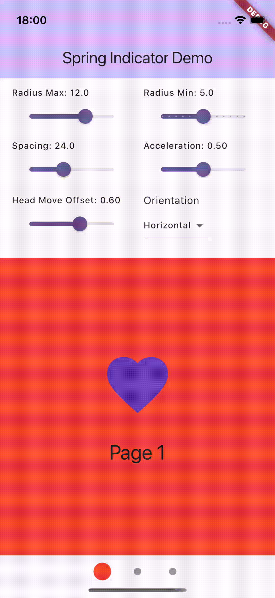

# Spring Indicator

[](https://pub.dev/packages/spring_indicator)
[![style: very good analysis][very_good_analysis_badge]][very_good_analysis_link]
[![License: MIT][license_badge]][license_link]

A Flutter page indicator widget that animates with a satisfying spring-like
stretching effect between dots as the user swipes through pages.

The active dot stretches toward the next dot while scrolling, then snaps back —
mimicking the behaviour of a spring. Dot sizes, spacing, colors, and animation
timing are all configurable.

---

## Features ✨

- 🟣 **Spring animation** — the active dot stretches and snaps as pages change.
- 🎨 **Flexible coloring** — set a single active color or supply one color per page.
- ↔️ **Horizontal & vertical** — lay the dots out along either axis.
- ⚙️ **Tunable physics** — control dot sizes, spacing, acceleration, and the head/foot offset independently.

---



---

## Installation 💻

**❗ In order to start using Spring Indicator you must have the [Flutter SDK][flutter_install_link] installed on your machine.**

Add the package to your project:

```sh
flutter pub add spring_indicator
```

---

## Usage 🚀

### Basic usage

Provide a `PageController` and the number of pages. The indicator automatically
subscribes to the controller and repaints as the user scrolls.

```dart
import 'package:flutter/material.dart';
import 'package:spring_indicator/spring_indicator.dart';

class MyPage extends StatefulWidget {
  const MyPage({super.key});

  @override
  State<MyPage> createState() => _MyPageState();
}

class _MyPageState extends State<MyPage> {
  final _controller = PageController();

  @override
  void dispose() {
    _controller.dispose();
    super.dispose();
  }

  @override
  Widget build(BuildContext context) {
    return Scaffold(
      body: Column(
        children: [
          Expanded(
            child: PageView(
              controller: _controller,
              children: const [
                ColoredBox(color: Colors.red),
                ColoredBox(color: Colors.green),
                ColoredBox(color: Colors.blue),
              ],
            ),
          ),
          Padding(
            padding: const EdgeInsets.only(bottom: 32),
            child: SpringIndicator(
              controller: _controller,
              itemCount: 3,
              color: Colors.deepPurple,
            ),
          ),
        ],
      ),
    );
  }
}
```

### Per-page colors

Supply a `colors` list (one entry per page) to give each dot its own active color:

```dart
SpringIndicator(
  controller: _controller,
  itemCount: 3,
  colors: [Colors.red, Colors.green, Colors.blue],
  inactiveColor: Colors.black26,
),
```

### Vertical layout

Set `axis` to `Axis.vertical` to stack the dots vertically:

```dart
SpringIndicator(
  controller: _controller,
  itemCount: 3,
  axis: Axis.vertical,
  color: Colors.deepPurple,
),
```

### Custom sizing & animation

```dart
SpringIndicator(
  controller: _controller,
  itemCount: 5,
  radiusMax: 10,       // active dot radius
  radiusMin: 4,        // inactive dot radius
  spacing: 16,         // gap between dots
  acceleration: 0.3,   // spring head acceleration (0.0–1.0)
  headMoveOffset: 0.7, // when the head starts moving (0.0–1.0)
  color: Colors.teal,
),
```

---

## Parameters ⚙️

| Parameter | Type | Default | Description |
|---|---|---|---|
| `controller` | `PageController` | **required** | The `PageController` that drives the animation. |
| `itemCount` | `int` | **required** | Number of pages (and dots). Must be > 0. |
| `radiusMax` | `double` | `8` | Radius of the active dot in logical pixels. |
| `radiusMin` | `double` | `5` | Radius of an inactive dot in logical pixels. |
| `spacing` | `double` | `24` | Gap between adjacent dots in logical pixels. |
| `color` | `Color` | `Color(0xFF2196F3)` | Active dot color (used when `colors` is null). |
| `colors` | `List<Color>?` | `null` | Per-page active colors. Length must equal `itemCount`. |
| `inactiveColor` | `Color` | `Color(0xFFBDBDBD)` | Color of inactive dots. |
| `acceleration` | `double` | `0.5` | How quickly the spring head accelerates. Clamped to `[0.0, 1.0]`. |
| `headMoveOffset` | `double` | `0.6` | Scroll progress fraction at which the spring head begins moving. Clamped to `[0.0, 1.0]`. |
| `axis` | `Axis` | `Axis.horizontal` | Layout direction of the dots. |

### `acceleration`

Controls the spring tension:

- `0.0` — the head stays still until the foot catches up (maximum stretch).
- `1.0` — head and foot move together (no spring effect).
- `0.5` — the default, a balanced spring feel.

### `headMoveOffset`

Mirrors the behaviour of the [Android Spring Indicator][android_spring_link]:

- The **head** starts moving immediately (at 0 % of the swipe).
- The **foot** starts moving at `(1 − headMoveOffset) × 100 %` of the swipe
  (40 % with the default value of `0.6`).

---

## Continuous Integration 🤖

Spring Indicator comes with a built-in [GitHub Actions workflow][github_actions_link] powered by [Very Good Workflows][very_good_workflows_link].

On each pull request and push, the CI `formats`, `lints`, and `tests` the code.
The project uses [Very Good Analysis][very_good_analysis_link] for strict analysis options.
Code coverage is enforced using [Very Good Coverage][very_good_coverage_link].

---

## Running Tests 🧪

For first time users, install the [very_good_cli][very_good_cli_link]:

```sh
dart pub global activate very_good_cli
```

To run all unit tests:

```sh
very_good test --coverage
```

To view the generated coverage report you can use [lcov](https://github.com/linux-test-project/lcov):

```sh
# Generate Coverage Report
genhtml coverage/lcov.info -o coverage/

# Open Coverage Report
open coverage/index.html
```

---

## License 📄

This project is licensed under the [MIT License][license_link].

[android_spring_link]: https://github.com/chenupt/SpringIndicator
[flutter_install_link]: https://docs.flutter.dev/get-started/install
[github_actions_link]: https://docs.github.com/en/actions/learn-github-actions
[license_badge]: https://img.shields.io/badge/license-MIT-blue.svg
[license_link]: https://opensource.org/licenses/MIT
[very_good_analysis_badge]: https://img.shields.io/badge/style-very_good_analysis-B22C89.svg
[very_good_analysis_link]: https://pub.dev/packages/very_good_analysis
[very_good_cli_link]: https://pub.dev/packages/very_good_cli
[very_good_coverage_link]: https://github.com/marketplace/actions/very-good-coverage
[very_good_workflows_link]: https://github.com/VeryGoodOpenSource/very_good_workflows
